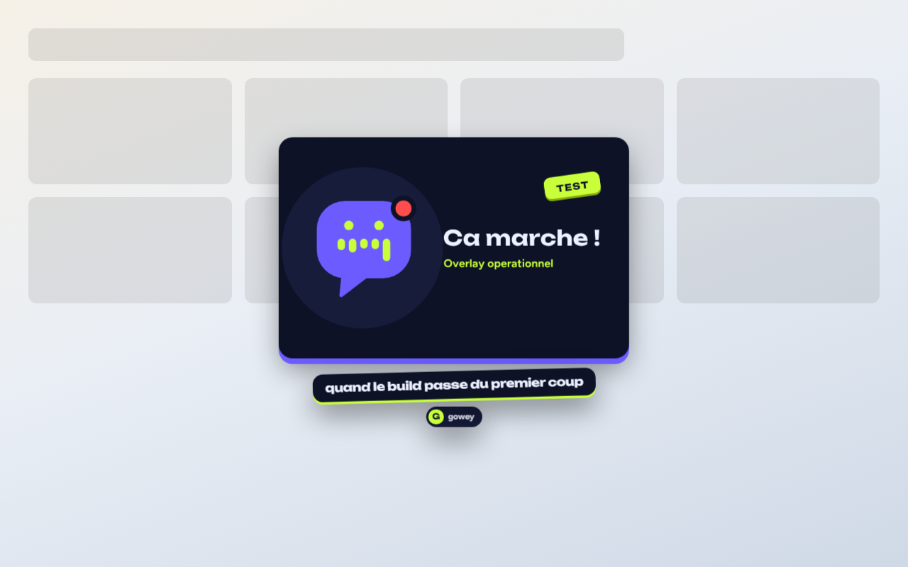

LiveMemes sait maintenant monter tes memes. Balance un meme depuis Discord ou
depuis l'app, il s'affiche en plein ecran chez tous les membres de ton salon vocal.

## Nouveau dans cette version

- **Qui est dans le vocal** : une colonne d'avatars sur le cote de l'ecran
  montre les membres de ton salon vocal. Pastille verte : il voit les memes ;
  grise : il n'a pas l'app ouverte ; orange barree : il est en sourdine. Cote,
  taille et ecran se reglent dans l'app, et elle se masque quand tu es seul.
- **Banque de memes** : dans l'editeur, "Banque de memes" propose des videos
  brutes, sans texte. Pioches-en une, ajoute ta phrase et envoie.
- **Memes dans les coins** : un grand meme en haut a gauche (ou dans un autre
  coin) n'est plus coupe a moitie, il se cale dans le coin.

Depuis la 0.1.0, l'installeur Windows et l'AppImage se mettent a jour tout
seuls : redemarre l'app quand elle le propose.

## Installer

| Systeme | Fichier |
| --- | --- |
| Windows | `LiveMemes-*-win-x64.exe` (installeur) ou `...-win-x64.zip` pour lancer sans installer |
| macOS Apple Silicon | `LiveMemes-*-mac-arm64.dmg` |
| macOS Intel | `LiveMemes-*-mac-x64.dmg` |
| Linux | `LiveMemes-*-linux-x86_64.AppImage` |

Les binaires ne sont pas signes :

- **Windows** — SmartScreen affiche "Windows a protege votre ordinateur" :
  Informations complementaires puis Executer quand meme.
- **macOS** — au premier lancement, clic droit sur l'app puis Ouvrir. Si macOS
  refuse malgre tout, `xattr -cr /Applications/LiveMemes.app` dans le Terminal.
- **Linux** — rends l'AppImage executable : `chmod +x LiveMemes-*.AppImage`.

## Utiliser

1. Lance l'app. Elle vit dans la barre de menus (macOS) ou la zone de
   notification (Windows), pas dans la barre des taches.
2. Suis le tutoriel : dans Discord, tape `/livememes link`, le bot te donne un
   code a coller dans l'app. Il n'y a aucune adresse de serveur a renseigner.
3. Rejoins un salon vocal, puis `/meme url` ou `/meme fichier`, ou passe par
   l'editeur de l'app et clique sur Envoyer.

Le meme s'affiche chez tous les membres du vocal qui ont l'app ouverte. Les
reponses du bot sont privees : personne d'autre que toi ne les voit dans le
salon textuel.

## Reglages utiles

`/livememes mute` coupe la reception, `/livememes clear` efface ce qui est a
l'ecran, `/livememes status` dit qui, dans ton vocal, peut recevoir des memes.
Dans l'app : sourdine, volume, choix des ecrans d'affichage, memes en haut a
gauche, croix de fermeture, lancement au demarrage.

L'overlay ne bloque jamais un clic : la souris le traverse.

## Connu

- Mises a jour automatiques sur Windows (installeur) et Linux (AppImage) :
  l'app telecharge la nouvelle version et propose de redemarrer. Sur macOS et
  avec le zip Windows, elle signale la nouvelle version, a telecharger a la main.
  Depuis une version anterieure a cette fonctionnalite, reinstalle une fois a la
  main.
- Un jeu en mode video exclusif (plein ecran natif) peut passer devant
  l'overlay. Le mode fenetre sans bordure marche toujours.
