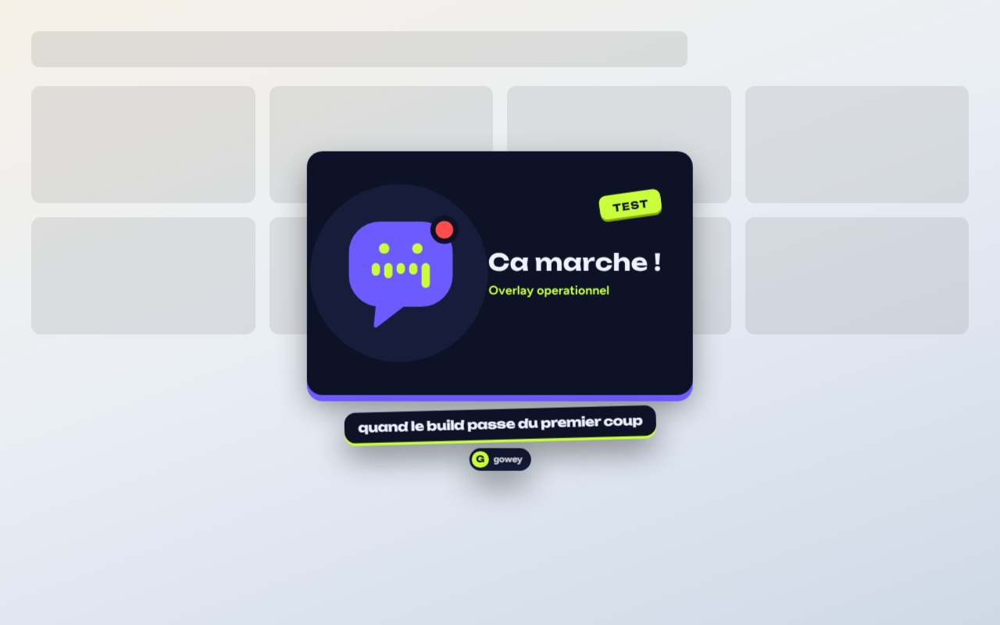
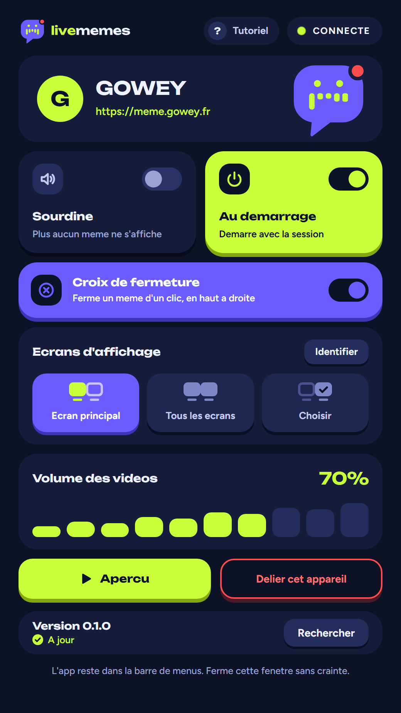
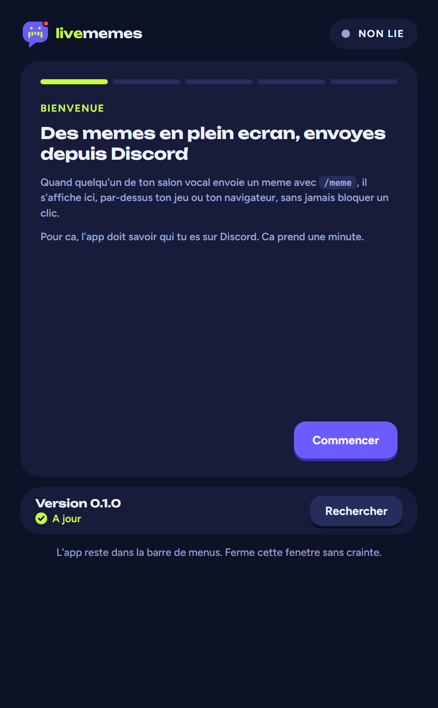

<p align="center">
  <picture>
    <source media="(prefers-color-scheme: dark)" srcset="livememes-logo/svg/livememes-logo-dark.svg" />
    
  </picture>
</p>

# LiveMemes

Balance un meme depuis Discord, il s'affiche **en plein ecran chez tous les membres
du salon vocal** — par-dessus le jeu, le navigateur, n'importe quoi. Dans l'esprit
de MemeDrop.

<p align="center">
  
</p>

```
/meme gif recherche:chat qui tape au clavier
        │
        ▼
   bot Discord ──► backend ──► WebSocket ──► overlay Electron (x N personnes)
```

## Comment ca marche

1. Le bot regarde dans **quel salon vocal** se trouve l'auteur de la commande.
2. Il resout le meme (URL ou piece jointe) et le **telecharge sur le backend** —
   les URLs du CDN Discord expirent, on ne peut pas les envoyer telles quelles.
3. Il pousse le meme via WebSocket a **tous les membres du vocal** qui ont l'overlay
   ouvert et lie a leur compte Discord.
4. L'overlay affiche le meme dans une fenetre transparente, toujours au premier plan,
   et **traversante par la souris** : ca ne bloque jamais un clic.

## Structure

| Package | Role |
| --- | --- |
| `packages/shared` | Le protocole WebSocket, partage par les deux cotes |
| `packages/server` | Bot Discord + API HTTP + relais WebSocket + cache media |
| `packages/desktop` | L'overlay Electron (barre de menus, transparent, always-on-top) |

## Installation

```bash
npm install
cp .env.example .env   # puis remplis DISCORD_TOKEN et DISCORD_CLIENT_ID
```

### Creer l'application Discord

1. [discord.com/developers/applications](https://discord.com/developers/applications) → **New Application**
2. Onglet **Bot** → *Reset Token* → colle-le dans `DISCORD_TOKEN`
3. Onglet **General Information** → *Application ID* → `DISCORD_CLIENT_ID`
4. Onglet **Installation** → coche `applications.commands` et `bot`, permission
   *Send Messages* → utilise le lien d'installation genere pour inviter le bot

Aucun intent privilegie n'est necessaire : le bot utilise `Guilds` et
`GuildVoiceStates`, tous deux publics.

Mets `DISCORD_DEV_GUILD_ID` pendant le developpement : les commandes apparaissent
instantanement sur ce serveur, au lieu d'attendre jusqu'a une heure en global.

## Lancer

```bash
npm run commands:deploy   # une fois, et a chaque changement de commande
npm run dev               # backend + bot
npm run dev:desktop       # overlay (autre terminal)
```

L'overlay vise `https://meme.gowey.fr` (prod) par defaut. Pour le brancher sur un backend
local, lance-le avec `LIVEMEMES_SERVER=http://localhost:8787 npm run dev:desktop` :
c'est la seule facon de changer de serveur, l'URL n'est plus saisissable dans l'app.

### Premiere ouverture : lier l'app a ton compte Discord

Tant que l'appareil n'est pas lie, l'app s'ouvre sur un tutoriel qui reprend ces
etapes :

1. **Dans Discord** : dans n'importe quel salon textuel du serveur ou le bot est
   present, tape `/livememes link`. Le bot repond avec un code de 8 caracteres,
   dans un message visible par toi seul.
2. **Dans l'app** : colle ce code et valide. Il expire au bout de quelques minutes
   (5 par defaut, `PAIRING_TTL_MS`) : s'il est perime, refais `/livememes link`.
   Apres 10 essais rates en 10 minutes, le serveur refuse les tentatives un moment.
3. **C'est lie** : l'app affiche ton pseudo et propose un meme de test, visible
   seulement sur ton ecran.
4. **Ensuite** : rejoins un salon vocal. Tu recois les memes envoyes par les
   personnes presentes (`/meme url`, `/meme fichier`), et `/livememes mute`
   coupe la reception.

Le tutoriel se rouvre depuis le bouton "Tutoriel" en haut des reglages. Si l'appareil
est delie (`/livememes unlink`, token refuse par le serveur), l'app revient
d'elle-meme a l'etape `/livememes link`.

Les reglages choisissent ou s'affichent les memes : ecran principal (defaut),
tous les ecrans, ou une selection. "Identifier" affiche le numero de chaque
ecran. Un ecran choisi puis debranche est ignore ; si aucun ecran choisi n'est
branche, l'overlay retombe sur l'ecran principal.

<p align="center">
  
  
</p>

> **`PUBLIC_URL` compte.** C'est l'URL que les overlays utilisent pour telecharger
> les medias. En `localhost`, seuls les overlays de ta propre machine verront
> quelque chose. Pour tester a plusieurs, expose le backend (Cloudflare Tunnel,
> ngrok, un VPS) et mets cette URL dans `PUBLIC_URL`.

## Heberger le backend

Le backend est la seule partie a heberger : il fait tourner le bot, le relais
WebSocket et le cache media. L'overlay se contente de s'y connecter. Il tient
dans ~150 Mo de RAM, HTTP et WebSocket partagent le port **8787**.

### Coolify

1. **New Resource → Docker Compose**, pointe sur ce depot, fichier
   `docker-compose.yaml`.
2. **Environment Variables** — les trois obligatoires :

   | Variable | Valeur |
   | --- | --- |
   | `DISCORD_TOKEN` | Le token du bot |
   | `DISCORD_CLIENT_ID` | L'Application ID |
   | `PUBLIC_URL` | `https://ton-domaine` — exactement le domaine de l'etape 3 |

3. **Domains** — attache un domaine au service `server`, port `8787`. Coolify
   pose le TLS et route via son proxy. Le WebSocket (`/ws`) passe par la meme
   route, sans configuration supplementaire.
4. **Premier deploiement** : mets `DEPLOY_COMMANDS_ON_BOOT=true` pour enregistrer
   les slash commands automatiquement, puis **repasse-le a `false`** (Discord
   plafonne la creation de commandes globales a 200/jour, et un conteneur qui
   redemarre en boucle epuiserait le quota). Sinon, lance
   `npm run commands:deploy` une fois depuis le terminal Coolify.
5. L'app desktop pointe sur `https://meme.gowey.fr`, fige dans `SERVER_URL`
   (`packages/desktop/src/main/store.ts`). Un autre domaine impose de changer
   cette constante et de reconstruire le client.

> **Le volume `livememes-data` n'est pas optionnel.** Il contient la base SQLite
> des appareils lies. S'il disparait, tout le monde doit refaire
> `/livememes link`. Ne coche pas la suppression des volumes au redeploiement.

`PUBLIC_URL` est l'autre piege : c'est l'URL que les overlays utilisent pour
telecharger les medias. Si elle ne correspond pas au domaine reellement servi,
les commandes repondent normalement dans Discord mais aucun meme ne s'affiche.

### Sans Coolify

```bash
docker compose -f docker-compose.yaml -f docker-compose.local.yaml up -d --build
```

Le second fichier publie le port sur l'hote — inutile, et deconseille, derriere
un proxy qui gere deja le TLS.

### Dimensionnement

Le cache media grossit avec l'usage et se purge tout seul selon
`MEDIA_TTL_HOURS` (24h par defaut). Quelques Go de volume suffisent largement.

## Commandes

### `/meme` — balance un meme dans ton salon vocal

| Sous-commande | Ce que ca fait |
| --- | --- |
| `/meme url url:<lien>` | Une image, un GIF ou une video depuis une URL |
| `/meme fichier fichier:<upload>` | Un fichier depuis ton disque |

Options communes : `texte` (legende), `duree` (secondes), `taille`
(petit/moyen/grand/plein ecran), `position` (centre, coins, aleatoire), `volume`.

Une video est jouee une fois, jusqu'a la fin, puis disparait. `duree` devient
alors un plafond, et `DROP_MAX_VIDEO_DURATION_MS` (60 s par defaut) coupe les
videos plus longues. Images et GIF restent affiches pendant `duree`
(`DROP_DEFAULT_DURATION_MS`, plafonne par `DROP_MAX_DURATION_MS`).

Une croix discrete en haut a droite de chaque meme le ferme d'un clic, sur ton
ecran seulement : les autres membres du vocal le gardent, et le suivant de la
file prend sa place. Hors de la croix, la souris traverse toujours l'overlay.
`Ctrl+Alt+Shift+X` (`Cmd+Alt+Shift+X` sur macOS) ou "Fermer les memes affiches"
dans la barre de menus ferment tout d'un coup. La croix se desactive dans les
reglages ; elle n'existe pas sous Linux, ou Electron ne sait pas rendre une
fenetre traversante sensible au survol (le raccourci et le menu marchent).

Plusieurs memes envoyes d'affilee s'affichent l'un apres l'autre, dans l'ordre
d'arrivee : chaque ecran a sa file de 8 memes en attente. File pleine, les
nouveaux sont ignores ; un meme qui attend plus de 2 minutes saute.
`/livememes clear` vide aussi la file.

### Editeur : monter un meme sans quitter l'app

"Ouvrir l'editeur" (fenetre de reglages, ou "Editeur..." dans la barre de menus)
ouvre une fenetre de montage rapide, facon story :

- **Import** d'une video (mp4, mov, webm), d'un GIF ou d'une photo (png, jpg,
  webp), par le bouton ou en glissant le fichier sur la fenetre.
- **Timeline a trois pistes** pour une video : la piste video se coupe par ses
  bords (30 s maximum par clip), la piste son garde ou coupe le son d'origine, la
  piste texte regle quand le texte apparait et disparait.
- **Un texte** a placer a la souris sur l'image, avec la police, la taille (curseur
  ou molette), la couleur et le contour au choix.
- **Enregistrer** exporte le resultat dans un dossier choisi au premier
  enregistrement, puis retenu.
- **Envoyer** le balance dans ton salon vocal comme un `/meme`, avec les memes
  options (taille, position, volume ou duree) et les memes regles (role,
  cooldown, sourdine). Le bilan s'affiche dans l'editeur, rien n'est poste dans
  Discord.

L'export passe par un ffmpeg embarque dans l'app. Une video sort en mp4 (H.264),
avec un debit calcule pour rester sous `MEDIA_MAX_BYTES` (25 Mo). Un GIF reste un
GIF, une photo sort en png ou en jpg.

### Restreindre a un role

`DROP_ROLE_ID` limite les memes aux porteurs d'un role, **a l'envoi comme a la
reception** : sans le role, `/meme` est refuse et rien ne s'affiche a l'ecran, meme
en etant dans le bon salon vocal. Non definie, la variable laisse tout le monde
eligible. `/livememes status` indique combien de membres du vocal sont exclus.

### `/livememes` — gerer ton overlay

| Sous-commande | Ce que ca fait |
| --- | --- |
| `link` | Donne un code d'appairage a coller dans l'app |
| `devices` | Liste tes appareils lies et leur etat |
| `unlink` | Delie tous tes appareils |
| `mute` | Coupe / reactive la reception des memes |
| `clear` | Efface les memes affiches (tout le vocal si tu es moderateur) |
| `status` | Qui, dans ton vocal, peut recevoir des memes |

## Construire l'app desktop

```bash
npm run ffmpeg --workspace @livememes/desktop   # ffmpeg de l'editeur, une fois
npm run dist:desktop                            # -> packages/desktop/release/
```

Cible ta plateforme courante. `npm run ffmpeg` telecharge le binaire ffmpeg de ta
plateforme (builds `ffmpeg-static`, sha256 verifies) dans
`packages/desktop/vendor/ffmpeg/`, d'ou electron-builder le reprend. Sans lui,
l'editeur cherche `ffmpeg` dans le PATH. ffmpeg est distribue sous licence GPL :
sa licence est livree a cote du binaire. Les binaires ne sont pas signes : macOS et Windows
afficheront un avertissement au premier lancement.

La charte graphique (couleurs, polices, composants, visuels d'installeur) est
decrite dans [`packages/desktop/DESIGN.md`](packages/desktop/DESIGN.md).

### Mises a jour automatiques

Le client verifie les GitHub Releases de `ArthurLsy/livememes` 15 s apres le
lancement puis toutes les 6 h (electron-updater, config `publish` de
`packages/desktop/package.json`). L'etat est visible dans les reglages et dans
le menu de la barre de menus ("Rechercher une mise a jour").

| Installation | Comportement |
| --- | --- |
| Windows, installeur NSIS | Telechargement en fond, installation au redemarrage ("Redemarrer pour installer") ou a la fermeture |
| Linux, AppImage | Idem, l'AppImage est remplacee sur place |
| macOS, zip Windows | L'app signale la nouvelle version et ouvre la page de release : mise a jour a la main |

macOS reste manuel tant que l'app n'est pas signee et notarisee : Squirrel.Mac
refuse d'installer une app non signee. Une version beta (`x.y.z-beta.n`) recoit
les prereleases ; une version stable ne recoit que les releases stables.

Un echec (reseau, release sans fichier `latest*.yml`, binaire dont le sha512 ne
correspond pas) s'affiche dans les reglages et laisse l'app tourner sur sa
version courante. Le serveur et le client se mettent a jour independamment :
un client pas encore redemarre doit rester compatible (`PROTOCOL_VERSION`).

### Publier une release

1. Monte `version` dans `package.json` (racine et `packages/desktop`).
2. Commit, puis `git tag vX.Y.Z[-beta.N] && git push origin vX.Y.Z[-beta.N]`.
3. Le workflow `release` verifie, construit les trois plateformes et attache a
   la release les binaires, les `latest*.yml` et les `.blockmap`. Sans ces `.yml`,
   aucun client ne voit la mise a jour.
4. Verifie la release sur GitHub et complete `.github/RELEASE_NOTES.md` si besoin.

Le depot doit etre public : electron-updater lit les releases sans
authentification.

## Tests

```bash
npm test
```

Couvre l'appairage, le relais WebSocket (livraison multi-ecrans, sourdine, cibles
hors ligne), l'envoi direct depuis l'editeur et le service de medias, sans avoir
besoin d'un vrai bot Discord. Cote desktop : la logique de l'overlay, la timeline
de l'editeur et les commandes ffmpeg qu'il genere.

## Limites connues

- **macOS, jeux en vrai plein ecran** : l'overlay s'affiche au-dessus des apps
  plein ecran natives, mais un jeu qui prend un mode video exclusif peut passer
  devant. Le mode fenetre sans bordure marche toujours.
- **Wayland (Linux)** : le positionnement des fenetres always-on-top est a la main
  du compositeur. X11 fonctionne de maniere fiable.
- **Pas de moderation automatique** du contenu. Le cooldown (`DROP_COOLDOWN_MS`),
  `DROP_ROLE_ID`, `/livememes mute` et `/livememes clear` sont les garde-fous fournis.
- Les tokens d'appareil sont stockes en clair dans la base SQLite du backend et dans
  `settings.json` cote client. Suffisant pour un serveur entre amis ; a durcir si tu
  ouvres le service.
